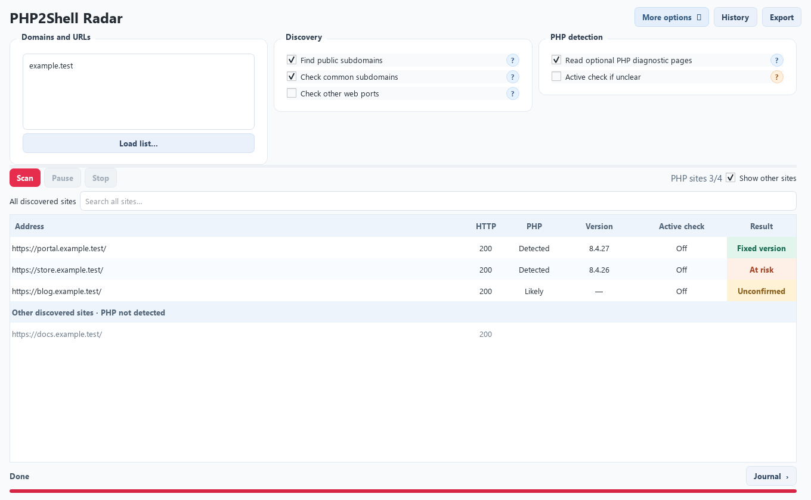

<div align="center">
  
  <h1>PHP2Shell Radar</h1>
  <p>Find your PHP websites. See which ones need attention.</p>
  <p><a href="https://github.com/Secragon/php2shell-radar/releases/latest">Download for Windows or Linux</a> · <a href="docs/TECHNICAL.md">How detection works</a> · <a href="docs/VALIDATION.md">Validation</a></p>
</div>

PHP2Shell Radar is a desktop asset-discovery and PHP exposure scanner for **CVE-2026-109618** and **CVE-2026-109619**. Enter a domain, run a scan, and review the PHP sites it finds. Public subdomain sources, common DNS names, certificate names and read-only PHP checks are available at first launch. More intensive discovery and active PHP checks are separate options with plain-language help in the app.



*Illustrative interface preview using example data. It is not a scan of a real organization.*

## Download and run

| Platform | Download | Run |
| --- | --- | --- |
| Windows 10/11, x64 | [`PHP2Shell-Radar-windows-x64.exe`](https://github.com/Secragon/php2shell-radar/releases/latest) | Double-click the single EXE. No installer, Python or console window. |
| Linux, x64 | [`PHP2Shell-Radar-linux-x86_64.tar.gz`](https://github.com/Secragon/php2shell-radar/releases/latest) | Extract, then run `./PHP2Shell-Radar` in a desktop session. No Python installation. |

Download from the [latest release](https://github.com/Secragon/php2shell-radar/releases/latest). Each release includes `SHA256SUMS` for checking the downloads. Linux needs standard system graphics libraries; the archive is built and checked on Ubuntu 22.04 and may need a newer system library on older distributions. The app stores sessions locally under the current user's application-data directory. You can export JSON or CSV reports to a location you choose.

## What happens during a scan

1. **Enter a domain or URL.** A bare domain checks web ports 80 and 443. A full URL retains its protocol, port, path and query.
2. **Find websites.** Enabled public-source, DNS and certificate discovery gather candidate subdomains. Radar checks DNS and then HTTP before counting a candidate as a reached website.
3. **Recognize PHP.** Headers, cookies, HTML paths, generator metadata, CMS hints and other response evidence can identify PHP without a public `phpinfo` page. The results table shows PHP findings first and updates the `PHP sites / reached websites` count as the scan runs.
4. **Assess exposure.** A visible PHP version can indicate an upstream fixed or older build. With **Active PHP check** explicitly enabled, a small session check can also reveal PHP hidden from passive inspection. Repeated pre-fix behavior can confirm an unpatched code path. Only sites already identified as PHP may receive bounded memory-pressure requests if that small check is inconclusive. Open a result to see the evidence and limits behind its label.
5. **Review the rest.** After the scan finishes, **Show other sites** reveals reached websites without PHP indicators. They are not given vulnerability labels. The Journal button expands the detailed activity log.

| Result | Meaning |
| --- | --- |
| **Fixed version** | The site reports an upstream PHP version that contains the official fixes. Vendor build details still matter. |
| **At risk** | The site reports an older PHP version. A vendor may have backported a fix. |
| **Unconfirmed** | The PHP version or patch state could not be established. This is not a clean bill of health. |
| **Vulnerable** | Two active requests reproduced the validated pre-fix session behavior without conflicting patch evidence. This shows an unpatched code path, not code execution. |

The active option can exercise PHP memory-pressure paths and may interrupt a worker or an in-flight request. It is **off by default** and its in-app help explains the impact before use. Ordinary OOM, timeout, server error and a single warning do not count as proof. Passive evidence can also be absent, stale or altered by proxies. Radar does not claim a complete asset inventory or prove that every server worker is patched. See [the technical guide](docs/TECHNICAL.md), [passive detection](docs/PASSIVE_DETECTION.md) and [active validation](docs/VALIDATION.md) for the exact checks and boundaries.

## Build from source

Python 3.11+ is required for development. On Windows:

```powershell
python -m venv .venv
.venv\Scripts\python.exe -m pip install -e ".[build-windows]"
.venv\Scripts\python.exe -m hunter
.venv\Scripts\python.exe scripts\build_windows.py
```

On Linux:

```sh
python3 -m venv .venv
.venv/bin/python -m pip install -e '.[build-linux]'
.venv/bin/python -m hunter
.venv/bin/python scripts/build_linux.py
```

The local packaged output goes to `release/`. Tagged versions build both platforms in [GitHub Actions](.github/workflows/release.yml). Run the offline unit suite with `python -m unittest discover -s tests -v`; tests use mocks or localhost and do not scan third-party sites.

## Privacy and responsible use

Scan only assets you own or are authorized to assess. Sessions and exports stay on your machine; the app does not upload results to Secragon. Discovery may query public third-party services, and active checks send requests to target sites. Reports can contain hostnames, URLs and infrastructure metadata. Local storage is unencrypted; avoid putting secrets in URL queries.

For a suspected security issue in Radar itself, see [SECURITY.md](SECURITY.md). Licensed under [Apache 2.0](LICENSE). Copyright © 2026 Secragon.
